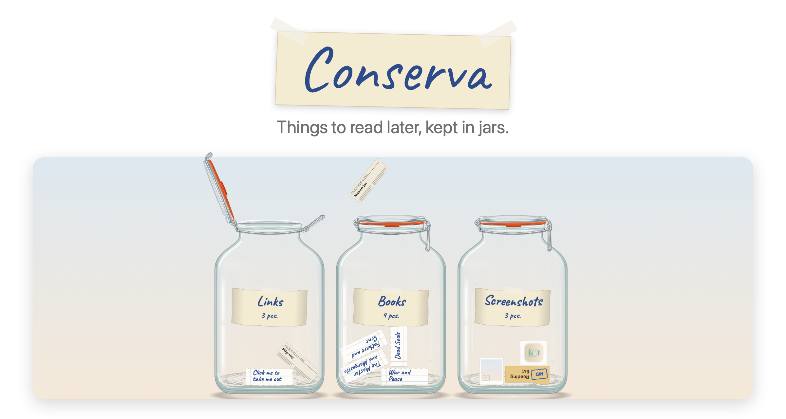
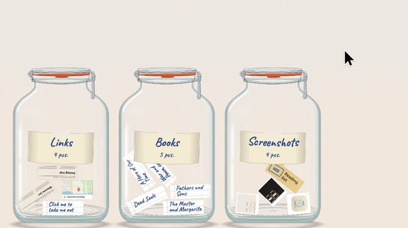
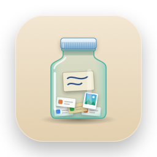

<picture>
  <source media="(prefers-color-scheme: dark)" srcset="docs/images/hero-dark.png">
  
</picture>

<h3 align="center">Things to read later, kept in jars.</h3>

<p align="center">
  Free and open source. For macOS 14 and later.
  <br>
  <a href="https://github.com/zinchenko39/conserva/releases/latest">Download&nbsp;&rsaquo;</a>
  &nbsp;&nbsp;
  <a href="#build-from-source">Build from source&nbsp;&rsaquo;</a>
</p>

<br>

## Out of sight. On the shelf.

Glass 5-litre jars, the kind every Soviet pantry had, stand along the bottom of your screen.
Rest the pointer on the left edge and they slide out. Move away and they slide off to the nearest edge.

Put anything in: a link, a quote, a book title, a screenshot, a PDF.
Take things out one at a time.

<picture>
  <source media="(prefers-color-scheme: dark)" srcset="docs/images/demo-dark.gif">
  
</picture>

<br>
<br>

## In through the lid.

| | |
|:--|:--|
| Drag onto a jar | A link, selected text, a picture or any file goes in. The lid opens by itself. |
| <kbd>⌘</kbd>&thinsp;<kbd>V</kbd> or <kbd>⌃</kbd>&thinsp;<kbd>V</kbd> while the jars are out | Whatever you copied goes into the jar you used last. |
| Copy a link anywhere | The jars peek out from the edge for a few seconds. Rest the pointer on one and click it: the link goes in. Off in the menu if you prefer. |
| Menu bar icon → Put the clipboard in | The same, into the jar you pick. |

Links get their page title. Text becomes a slip titled by its first line. Pictures go in as little photos.
Every picture and file is copied into Conserva's own folder, so moving or deleting the original does not empty the jar.

<br>

## Out one at a time.

| | |
|:--|:--|
| Click a slip in a jar | That one slip comes out through the neck and falls to the bottom of the screen. The lid stays open for the next one. |
| <kbd>Return</kbd> | One thing at random from the jar you used last. |
| Open, Copy, Show, Delete, Put back | On the card over the thing you took out. |
| Drag it from the floor | Into any app, as a link, text or file. |

Things left out go back into their jar when the jars hide.

<br>

## Glass you can pick up.

| | |
|:--|:--|
| Rest the pointer on the left edge of the screen | The jars slide out. |
| <kbd>⌃</kbd>&thinsp;<kbd>⌥</kbd>&thinsp;<kbd>J</kbd> | Show or hide the jars. |
| Click the lid | The lever lets go and the lid swings back on its hinge, or swings down and clamps shut. |
| Drag a jar by the body | Carry it, shake it, stand it on another jar. Let go and it falls until it lands. Everything inside feels it. |
| Drag a jar by the neck | Tilt it, turn it over. With the lid open, things pour out. |
| <kbd>Space</kbd> | The jar hops. |
| Double-click the label | Rename the jar. |
| Right-click a jar | Take out at random, paste, rename, empty, remove. |

Jars knock into each other and stack into columns; pull one out from the bottom and the rest come down.
A jar that falls over stays on its side until you pick it up. Up to five jars.

Paper yellows and photos fade the longer they sit in a jar, and a jar nothing has been taken out of for a while
gathers dust on its glass (the menu sets how long, or never). The glass rings when jars meet,
and the lid's wire clicks; every sound is synthesised as it happens, and the menu turns them off.

<br>

## Private by design.

No account. No analytics.
The only thing Conserva sends anywhere is a request for a page's title and picture when you put a link in,
and you can turn that off in the menu. Links to localhost, local network names or bare IP addresses are never fetched.

To peek out when you copy a link, Conserva watches the clipboard's change counter and asks the system whether
the new contents look like a web address (a yes-or-no answer, on macOS 15.4 and later). It never reads what you
copied until you click a jar to put it in. The menu turns the peeking off.

Everything is kept in `~/Library/Application Support/Conserva`: `shelf.json` and a `files/` folder with a copy of
every picture and file you put in. Nothing is written anywhere else, unless you turn on the trace file for a bug
report (`defaults write app.conserva.Conserva trace -bool true`), which logs when the jars came and went, never
what is in them.

<br>

## Living with it.

Conserva lives in the menu bar; it has no Dock icon and no windows. Quit it from its menu.

Download the latest release, unzip it and move `Conserva.app` to your Applications folder, or build it
from source (below). Releases are signed ad hoc, not notarised, so the first time macOS will say the app
cannot be checked: open it with right-click → Open, or run `xattr -d com.apple.quarantine /Applications/Conserva.app`.

To uninstall: quit Conserva, turn off "Open at login" in its menu first if you had it on, delete the app,
and delete `~/Library/Application Support/Conserva` if you do not want the jars' contents kept.

<br>

## Tech Specs

| | |
|:--|:--|
| **Compatibility** | macOS 14 Sonoma or later, on Apple silicon and Intel |
| **Size** | 3 MB |
| **Languages** | English, Russian, Spanish |
| **Built with** | Swift, AppKit and SpriteKit |
| **Network access** | Page titles and pictures for links, and only if you leave it on |
| **Price** | Free |
| **License** | MIT |

<br>

## Build from source

```sh
git clone https://github.com/zinchenko39/conserva.git
cd conserva
swift test
scripts/build-app.sh
open build/Conserva.app
```

The Command Line Tools are enough (`xcode-select --install`); Xcode is optional.
With the Command Line Tools for macOS 27, the script falls back to the macOS 26 SDK installed alongside them.
Local builds are signed ad hoc.

<details>
<summary>Inside the app</summary>
<br>

| File | Role |
|:--|:--|
| `AppDelegate.swift` | Menu bar, shortcut, showing and hiding the jars, the card |
| `ShelfPanel.swift` | The transparent layer over the screen the jars stand in |
| `ShelfScene.swift` | All motion: jars under gravity, carrying, tilting, pouring |
| `JarRig.swift` | One jar: its body, its swing-top lid and the box its contents are simulated in |
| `JarArt.swift` | Draws the jar, the lid, the label and everything that goes inside |
| `ShelfView.swift` | Mouse, keys, and drag and drop |
| `ShelfModel.swift` | The only thing that changes the shelf and saves it |
| `ItemCard.swift` | The card over a thing taken out |
| `Sounds.swift` | Glass, wire and rubber, synthesised |
| `FullScreen.swift` | Knows when to stay away |
| `GlobalShortcut.swift` | ⌃⌥J, through the system's hot key service |
| `Debug.swift` | The scripted test instance; see `CONTRIBUTING.md` |
| `Trace.swift` | The opt-in trace file for bug reports |
| `ConservaCore/` | The shelf model, storage, sorting what comes in, the jar's geometry. No AppKit, and tested |

Every picture in the app, the icon included, is drawn in code: the jars by `JarArt.swift`,
the icon by `scripts/make-icon.swift`. The images in this README are snapshots of the app itself.

Translations live in `Sources/Conserva/Resources`, one `.lproj` folder per language.

How the jars and their contents are simulated, how the app is tested from a terminal, and the rules for
changes are in `CONTRIBUTING.md`. Bugs and ideas go to
[github.com/zinchenko39/conserva/issues](https://github.com/zinchenko39/conserva/issues).

</details>

<br>

<p align="center">
  
  <br>
  <sub>MIT licensed, see <a href="LICENSE">LICENSE</a>. Labels are handwritten in <a href="https://github.com/googlefonts/caveat">Caveat</a> (SIL OFL), see <a href="THIRD_PARTY_NOTICES.md">THIRD_PARTY_NOTICES.md</a>.</sub>
</p>
